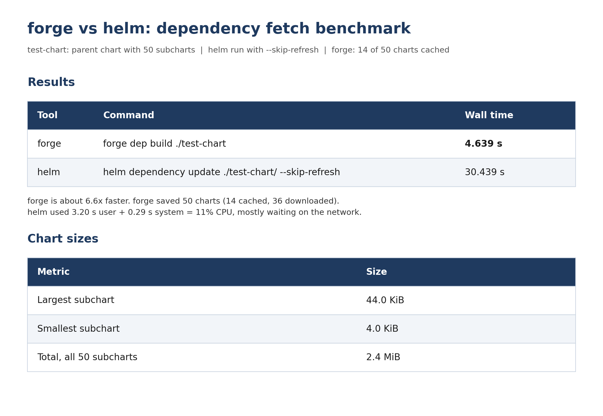

# forge

<p align="center">
  
</p>

`forge` replaces `helm dependency build` and `helm dependency update` for
charts whose dependencies are in OCI registries, classic chart repositories
(`https://…/index.yaml`) or local `file://` directories. It writes the same
`charts/*.tgz` and `Chart.lock` as Helm. Thus `helm template`, `helm install`
and `helm package` work without changes. They only get their dependencies
faster.

```sh
helm forge dep update ./my-chart   # resolve ranges, download, write Chart.lock
helm forge dep build  ./my-chart   # download exactly what Chart.lock pins
helm template my-release ./my-chart
```

`helm forge …` (the plugin) and `forge …` (the standalone binary) take the
same commands and flags.

## What's new in 2.1

- **Inspect dependencies.** `dep tree` shows the constraint, locked version,
  source and cache state of each dependency. `dep why NAME` explains one
  dependency. These two commands send no requests. `dep outdated` compares
  `Chart.lock` with the versions that registries offer now. Use
  `--fail-if-outdated` to stop a CI job when a dependency is outdated. See
  [Usage → `forge dep tree`](docs/usage.md#forge-dep-tree-chart).
- **Manage the cache.** `cache ls` lists the cached charts with their size
  and last use. `cache gc --older-than 30d --max-size 2GiB` removes the least
  recently used charts. You can run it while other forge processes run. See
  [Usage → `forge cache gc`](docs/usage.md#forge-cache-gc).

[Full release notes](https://github.com/mmpyro/forge/releases/tag/v2.1.0).

## What's new in 2.0

- **Chart repositories and `file://` dependencies.** forge now also fetches
  from classic `https://…/index.yaml` repositories, which includes `@name`
  references from `helm repo add`. It also packages local `file://` charts.
- **`-o json` output.** `dep build` and `dep update` can print one JSON
  report. The report gives the status, digest, size and error code of each
  dependency, and the request count for each host. See
  [Usage → JSON output](docs/usage.md#json-output).
- **Helm plugin.** Install forge with `helm plugin install` and run it as
  `helm forge`. The Homebrew tap is discontinued.

## Install as a Helm plugin (recommended)

You need Helm 3.18+ or Helm 4, on macOS, Linux or Windows (amd64/arm64).

1. Install a pinned release:

   ```sh
   # Helm 4: git sources can't be signature-verified, so --verify=false is required
   helm plugin install https://github.com/mmpyro/forge --version v2.1.0 --verify=false

   # Helm 3 (3.18+)
   helm plugin install https://github.com/mmpyro/forge --version v2.1.0
   ```

2. Check the install:

   ```sh
   helm plugin list          # forge  2.1.0  …
   helm forge --version
   ```

3. Use it in place of `helm dependency`:

   ```sh
   helm forge dep update ./my-chart
   helm forge dep build  ./my-chart
   helm forge dep build  ./my-chart -o json
   ```

The install hook downloads the release binary for your OS and architecture.
It checks the binary against `checksums.txt` of the release. If the checksum
does not match, the install stops. Always give `--version`. Without it, Helm
installs from `main`, and `main` can name a release that is not published.

To upgrade, remove the plugin and install the new version:

```sh
helm plugin uninstall forge
helm plugin install https://github.com/mmpyro/forge --version vX.Y.Z [--verify=false]
```

For mirrors, troubleshooting and the move from Homebrew, see
[Usage → Install](docs/usage.md#install).

## Standalone binary (v2.1.0)

Each [GitHub release](https://github.com/mmpyro/forge/releases) has prebuilt
binaries and a `checksums.txt` file. The links below go to
[v2.1.0](https://github.com/mmpyro/forge/releases/tag/v2.1.0)
([`checksums.txt`](https://github.com/mmpyro/forge/releases/download/v2.1.0/checksums.txt)).

| Platform | Asset | Download |
|---|---|---|
| macOS (Apple Silicon) | `forge-darwin-arm64` | [Download](https://github.com/mmpyro/forge/releases/download/v2.1.0/forge-darwin-arm64) |
| macOS (Intel) | `forge-darwin-amd64` | [Download](https://github.com/mmpyro/forge/releases/download/v2.1.0/forge-darwin-amd64) |
| Linux (x86_64) | `forge-linux-amd64` | [Download](https://github.com/mmpyro/forge/releases/download/v2.1.0/forge-linux-amd64) |
| Linux (ARM64) | `forge-linux-arm64` | [Download](https://github.com/mmpyro/forge/releases/download/v2.1.0/forge-linux-arm64) |
| Windows (x86_64) | `forge-windows-amd64.exe` | [Download](https://github.com/mmpyro/forge/releases/download/v2.1.0/forge-windows-amd64.exe) |
| Windows (ARM64) | `forge-windows-arm64.exe` | [Download](https://github.com/mmpyro/forge/releases/download/v2.1.0/forge-windows-arm64.exe) |

Install on macOS or Linux:

```sh
os=$(uname -s | tr '[:upper:]' '[:lower:]')
arch=$(uname -m); case $arch in x86_64) arch=amd64 ;; aarch64) arch=arm64 ;; esac
curl -fsSL -o forge "https://github.com/mmpyro/forge/releases/download/v2.1.0/forge-$os-$arch"
chmod +x forge && sudo mv forge /usr/local/bin/
forge --version
```

To build from source, see [Usage → Install](docs/usage.md#install).

## Guides

| Document | Read it to… |
|---|---|
| [Usage](docs/usage.md) | install forge, run it, set flags, cache it in CI, read its errors, parse its `-o json` output |
| [Architecture](docs/architecture.md) | learn how a run works and why it is fast and safe |
| [Development](docs/development.md) | build, test, regenerate goldens, run the compat gate and the benchmark |

## Benchmark

The test used a parent chart with 50 subcharts (2.4 MiB in total).
`forge dep build` took 4.6 s. `helm dependency update --skip-refresh` took
30.4 s. forge was about 6.6× faster. At the start, forge had 14 of the 50
charts in its cache. Helm spent most of the time on the network (11 % CPU).



For a comparison that you can repeat (40 charts, +50 ms latency, cold and
warm), run `make bench`. See
[Development → Benchmark](docs/development.md#benchmark-scriptsbenchsh).

## Why forge

- **Parallel.** forge fetches all dependencies at the same time, with a
  global limit and a limit for each host.
- **One auth handshake per registry.** The first request to a host runs
  alone. All other requests use the token that it gets.
- **Content-addressed cache.** forge stores archives by sha256. Charts,
  aliases and processes share them. A warm `dep build` sends zero requests.
- **Atomic `charts/`.** `charts/` changes only if all dependencies succeed.
- **Machine-readable reports.** With `-o json`, CI gets a stable error `code`
  for each failed dependency. CI does not have to parse text.
- **Same output as Helm.** CI compares archive bytes, `Chart.lock` (except
  `generated:`) and `helm template` output with real Helm 3 and Helm 4.

## Scope

Supported:

- `apiVersion: v2` charts
- dependencies with `repository:`
  - `oci://…`: OCI registries
  - `https://…` and `http://…`: classic chart repositories, added with
    `helm repo add` or not
  - `@name` and `alias:name`: repositories from Helm's `repositories.yaml`
    (forge also uses their credentials and TLS settings)
  - `file://…`: local chart directories, packaged as Helm packages them
- exact versions and semver ranges (with the same resolver rules as Helm)
- aliases, conditions and tags, prerelease and build-metadata versions

Not supported (forge stops before it sends a request):

- dependencies without a `repository` (unpacked in `charts/`), and other
  schemes (`s3://`, plugin getters)
- `apiVersion: v1` charts

Not available yet: `push`/`pull`, `package`, adaptive concurrency, HTTP/3.

## License

MIT. See [LICENSE](LICENSE).
