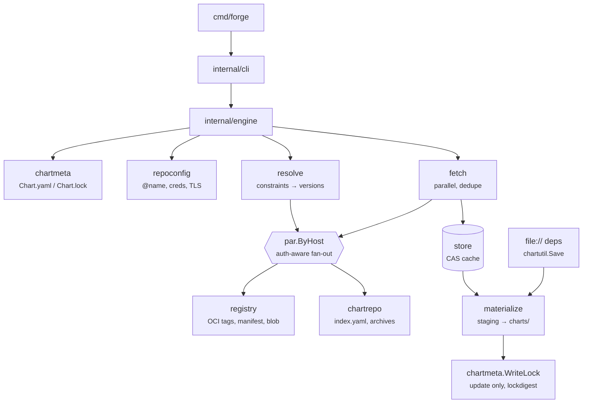
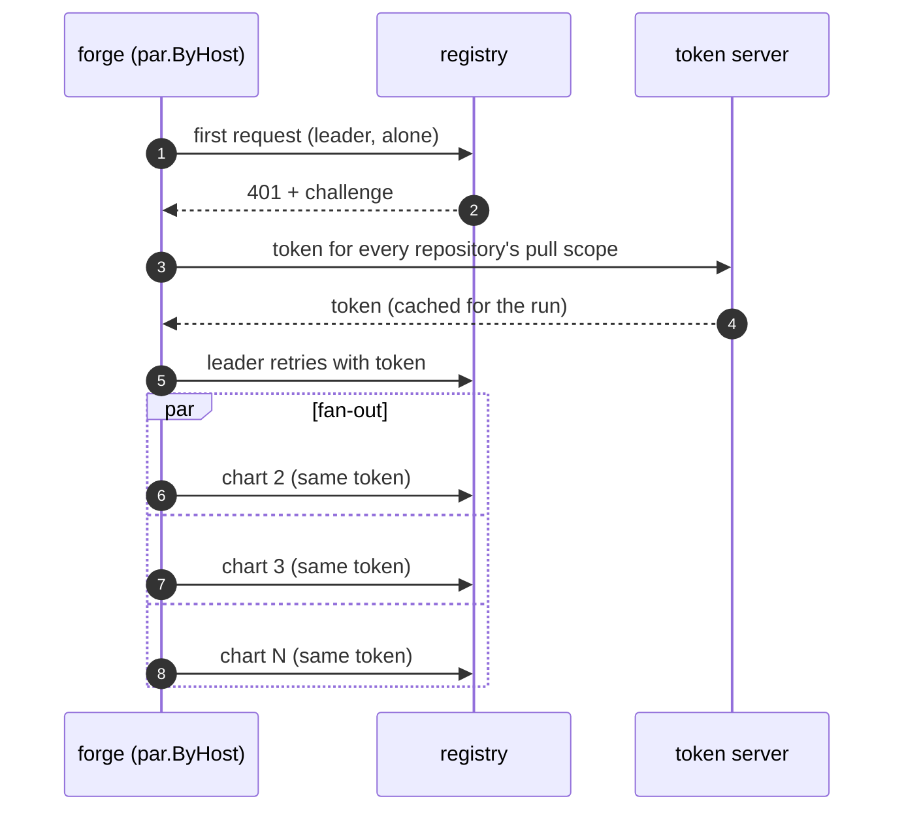

# Architecture

## A run, end to end



On the docs site, hover over a box to see its role. Click a box to go to the
section about it.

`dep update`:

1. `chartmeta.Load` reads the chart with the loader of Helm. Thus forge cleans
   the dependency fields exactly as Helm does before it calculates the hash.
   forge rejects `apiVersion: v1`.
2. `prepare` checks all repositories before the first network call. It
   accepts these types:
   - `oci://`
   - `http(s)://`
   - `file://` (the directory must exist)
   - `@name` and `alias:name` (the name must be in `repositories.yaml`).
     `prepare` replaces the name with its URL, because Helm hashes and locks
     the URL.

   `prepare` rejects all other types.
3. `resolve.Resolve` changes constraints into versions:
   - OCI: for exact versions, forge does not ask the registry. For a range,
     forge fetches the `tags/list` of the repository one time.
   - Chart repositories: forge always uses `index.yaml` (one time for each
     repository in a run). Thus the lock gets the spelling of the index, as
     in Helm.
   - `file://`: forge uses the version of the local chart, if it satisfies
     the constraint.
4. `install` fetches all remote dependencies and packages all `file://`
   dependencies (see below). If one of them fails, the run stops and
   `charts/` does not change.
5. `lockdigest.Compute` calculates the hash of
   `[Chart.yaml deps, locked deps]`. If it is equal to the digest of the
   current lock, forge does not change `Chart.lock`. If not, forge writes
   `Chart.lock` with the same bytes as Helm.

`dep build` does these steps: load, `prepare`, verify the lock digest,
`install`. If there is no lock, it runs `update`.

## Packages

| Package | Role |
|---|---|
| `cli` | cobra commands, flags, exit codes (`usageError` → 2), text and `-o json` output (`output.go`) |
| `engine` | `Build` / `Update` orchestration. `Summary` with one `Dep` (status, digest, size, placement, problem) for each dependency. `DependencyError`. `Inspect` (offline, for `dep tree` / `dep why`) and `Outdated` (`dep outdated`) |
| `chartmeta` | Load `Chart.yaml`/`Chart.lock` with the Helm v4 SDK, write `Chart.lock` |
| `lockdigest` | A copy of Helm's lock digest code. Helm keeps it in an `internal/` package that forge cannot import |
| `resolve` | Semver constraint → exact version from OCI `tags/list`, `index.yaml` or the local `file://` chart. `Available` / `Pick` / `Newest` for `dep outdated` |
| `registry` | oras-go client: credentials, shared token cache, error classification (`Classify` → `Problem` with a stable code). `registry.HTTP`: the HTTP/2 clients of the run, limits, retries and request counts for each host |
| `chartrepo` | Classic chart repositories: `index.yaml` (parsed as Helm's `repo` package parses it), archive URLs, credentials and TLS for each repository |
| `repoconfig` | Helm's `repositories.yaml`: `@name` resolution, credentials, TLS config |
| `par` | `ByHost`: the first request for each host runs alone, then the other requests run in parallel |
| `fetch` | Parallel scheduler, removes duplicates by repo:version and by digest/URL, streams blob → store |
| `store` | Content-addressed cache. `Entries` and LRU `GC` for `cache ls` / `cache gc` |
| `materialize` | Puts blobs into `charts/` with reflink → hardlink → copy, staging + swap |
| `testutil/fakeregistry` | In-memory OCI registry for unit tests, with a request log and fault injection |
| `testutil/fakerepo` | In-memory chart repository for unit tests, with a request log, basic auth and faults |

## Why it is fast

### One registry client per run

`registry.NewHTTP` makes the HTTP clients for the full process.
`registry.New` makes one oras `auth.Client` on top of them. All requests share
the connections (HTTP/2 when the server offers it), the token cache and the
concurrency limits. Chart repositories use the same clients and limits. A
chart repository with its own CA or client certificate gets a separate
connection pool, but it has the same request budget.

### One auth handshake per registry

If forge sent 40 requests to a cold registry, the registry would send 40 `401`
challenges, and forge would need 40 token requests. Two mechanisms prevent
this:

- `registry.WithPullScopes` puts the pull scope of *all* repositories into the
  first token request for each host. Thus one token covers all repositories.
- `par.ByHost` runs the first item of each host alone. forge answers its
  challenge and caches the token. Then the other items of that host run in
  parallel. The first items of different hosts run at the same time.



### Request budget

| Run | Requests |
|---|---|
| Cold `dep build` | ≈ `2 × unique OCI charts + 1 per registry` (manifest + blob for each chart, one auth round), plus `1 × unique chart-repository charts + 1 index.yaml per repository` |
| Warm `dep build` | `0` |
| `dep update` | One more `tags/list` for each OCI repository that has a range constraint, and one `index.yaml` for each chart repository |
| `file://` | `0`. forge packages the chart locally on each run |
| `dep tree`, `dep why`, `cache ls`, `cache gc` | `0`. These commands use only local files and the cache |
| `dep outdated` | One `tags/list` for each OCI repository (exact versions included) + `1 per registry` auth round, and one `index.yaml` for each chart repository. It downloads no charts |

The integration tests use a counting proxy to check these numbers. A change to
the order of fetch or auth steps can break them.

### Deduplication

- Items with the same `repo:version` (for example, three aliases of one chart)
  become one job.
- If jobs share a layer digest, forge downloads it one time (`singleflight`
  by digest).
- forge never downloads a blob again if it is already in the store. It does
  not matter which chart or project asked for it first.

### Limits and retries

`limitTransport` holds a global slot and a host slot for each request **until
the response body is closed**. The transfer continues after `RoundTrip`
returns. `limitTransport` takes the host slot first. Thus a request that waits
for a busy host does not hold a global slot that a different host could use.
Because forge counts slots for each host, blob redirects (ECR → S3, GHCR →
pkg-containers) get their own budget.

The retry layer is outside the limiter. Thus a retry waits for a free slot,
as all other requests do. The retry policy is:

- Retry on `408`, `429`, `5xx` and network errors.
- Retry up to 3 times.
- Wait 200 ms × 2ⁿ with 20 % jitter, or use `Retry-After` up to 30 s.

## The run report

Each run makes an `engine.Summary`. The text output prints its counts.
`-o json` (`cli/output.go`) prints all of it. forge fills the summary also
when the run fails. Thus a failed run still tells what happened to each
dependency.

- **For each dependency** (`Summary.Deps`, in `Chart.yaml` order): the status
  (`cached`, `downloaded`, `local`, `failed`, `skipped`), the locked version,
  the digest and size (from `fetch.Result`), the placement method in
  `charts/` (`materialize.Stage.Placement`) and the duration.
- **forge classifies errors.** `registry.Classify` maps OCI errors to a
  `registry.Problem`. `engine.repoProblem` maps chart repository errors to a
  `registry.Problem`. A `Problem` has a stable `code`, the HTTP status, a
  message and a hint. The text reason in `DependencyError` comes from the same
  `Problem`. Thus the text and the JSON always agree.
- **forge also assigns failures that occur before the fetch.**
  `resolve.NoMatchError` and `engine.UnsupportedError` are typed errors. The
  dependencies that they name get `failed`, and the other dependencies get
  `skipped`. Other early failures (lock out of sync, unknown `@name`, timeout)
  go to the top-level `error`.
- **Requests for each host.** `registry.HTTP` wraps each client in two
  counting transports. One is below the retry layer and counts each attempt
  and each `401` challenge. The other is above it and counts logical requests.
  Retries = attempts − logical requests. OCI registries and chart
  repositories share one `HTTP`, so the counts include both. The integration
  tests check that these counts are equal to the counts of the counting
  proxies.

## Distribution: the Helm plugin

forge is a Helm plugin (`plugin.yaml`). It uses the legacy format, so Helm
≥ 3.18 and Helm 4 can both load it.
`helm plugin install <repo> --version vX.Y.Z` clones the repository at that
tag. Then the platform install hook
(`scripts/install-plugin.sh` or `.ps1`) downloads the release binary that the
`version` in `plugin.yaml` names. The hook checks the binary against
`checksums.txt`. The release workflow rejects a tag that is different from
that `version`.

When Helm runs a plugin, it sets `HELM_PLUGIN_DIR`, `HELM_CACHE_HOME`,
`HELM_REGISTRY_CONFIG`, `HELM_REPOSITORY_CONFIG` and similar variables. forge
reads these variables. Thus `helm forge` uses the credentials and repositories
of Helm, and keeps its cache in `$HELM_CACHE_HOME/forge`
(`store.DefaultRoot`).

## Why it is safe

### The store

```
$HELM_FORGE_CACHE/
  blobs/sha256/<hex>                 chart archives, mode 0444
  refs/<registry>/<repo>/<version>   JSON: manifest digest, layer digest, size, fetched_at
  refs/<scheme>/<host>/<path>/<chart>/<version>   same for chart repositories, plus the archive file name
  tmp/                               in-flight writes
```

- forge writes each file to `tmp/` first. Then it uses `rename` to move the
  file into place. Thus concurrent forge processes share one cache without
  locks.
- forge calculates the hash of each blob while it streams. If the hash does
  not match, forge discards the blob and downloads it one more time. If it
  fails again, the dependency fails.
- `Open` removes `tmp/` files that are older than one hour. Crashed runs leave
  these files.
- forge trusts a cached `refs/` entry, unless you use `--refresh`. Because of
  this, a warm build sends zero requests.
- A cache hit touches its `refs/` file (`Store.Touch`). This is best effort: a
  read-only cache still serves hits. The mtime of the file is the "last used"
  time of the chart. `cache ls` shows this time, and `cache gc` uses it to
  select charts to remove.

### Garbage collection

`forge cache gc` (`Store.GC`) uses the mtimes of the ref files and the blobs
that they point to:

1. It removes refs that it cannot read or that point to a missing blob. It
   also removes refs that were not used within `--older-than`.
2. The last use of a blob is the newest last use of the refs that it keeps
   for that blob. It removes blobs that no kept ref points to.
3. While the kept blobs are larger than `--max-size`, it removes the least
   recently used blob and all of its refs.
4. It does not remove items that were used or written within `--grace`
   (default 1 h, the same as the `tmp/` cleanup). This protects a concurrent
   run between the time it finds a blob in the cache and the time it puts the
   blob into `charts/`. It also protects a blob whose ref is not written yet.
5. It removes empty directories under `refs/`. If `PutRef` loses a directory
   because of this, it makes the directory again.

GC takes no locks, as the other store operations do. If a run loses a blob
anyway, it gets a cache miss and downloads the blob again. The freed bytes are
the blob sizes. A blob that is hardlinked into a `charts/` directory keeps its
inode until you delete that link.

### Atomic `charts/`

1. forge puts the archives into `<chart>/.forge-staging/`. This directory is
   at the chart root, not in `charts/`. If a directory stayed in `charts/`,
   Helm would load it as a broken subchart.
2. Only if **all** dependencies succeed, forge renames the staged files into
   `charts/`. It also removes stale chart archives. As Helm does, it keeps
   files that are not charts, and directories.
3. If an error occurs, forge removes the staging directory and `charts/` does
   not change. If a killed run leaves a staging directory, the next run
   deletes it at the start.

### Placing files

`place` tries these methods in this order:

1. **reflink**: a copy-on-write clone (`clonefile` on macOS/APFS, `FICLONE`
   on Linux btrfs/XFS). The file is independent and uses no more disk space.
2. **hardlink**: the file shares the read-only inode of the cache. The
   archive in `charts/` is `0444`.
3. **copy**: a usual `0644` copy (for example, across file systems).

## Helm is the oracle

The output of forge must match real Helm, not a specification of Helm:

- `testdata/golden/` has `Chart.lock` files that real
  `helm dependency update` made. A difference is a forge bug. To regenerate
  the files, run `make golden`. Never edit them by hand.
- `make compat` runs each fixture through Helm 3, Helm 4 and forge. It
  compares the `charts/` listings, the archive sha256, `Chart.lock` (without
  `generated:`) and the `helm template` output.
- forge uses the same resolver rules as Helm:
  - Only strict semver tags count.
  - forge reads `_` in a tag as `+`.
  - forge does not look up exact versions.
  - The highest match wins.
- forge uses the same chart repository rules as Helm:
  - forge parses `index.yaml` strictly.
  - It drops entries that are not valid and sorts versions as Helm's `repo`
    package does.
  - It skips entries without URLs.
  - It resolves archive URLs relative to the repository URL.
  - The archive keeps the file name of its URL.
  - It sends credentials only to the scheme and host of the repository,
    unless `pass_credentials_all` is set.
- forge archives `file://` charts with Helm's `chartutil.Save`. Thus the tar
  stream is the same as Helm 4's for the same directory (the tar mtimes come
  from the files). The gzip bytes can be different when forge and Helm use
  different Go versions. Also, Helm 3 writes the current time into the
  entries. Thus `make compat` compares these archives by member names and
  contents.
- There is one intentional difference. `helm dependency build` rejects chart
  repository URLs that you did not add with `helm repo add`. forge fetches
  them with anonymous access.
