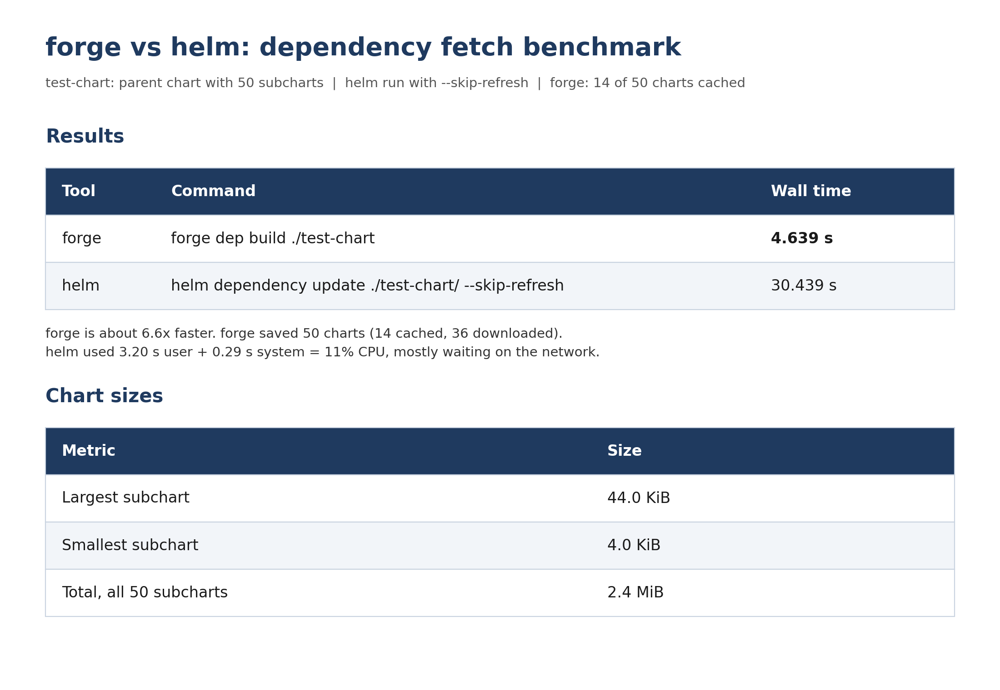

# Development

## Requirements

| For | Needs |
|---|---|
| build, unit tests | Go 1.25+ |
| integration, compat, golden | + `docker`, `helm` v4 on `PATH` |
| compat | + Helm 3 (`make helm3` downloads it to `.bin/helm3`) |
| bench | + `hyperfine`, `jq` |
| docs site | Python 3 (`make docs-serve` creates `.venv-docs/`) |

## Commands

```sh
make build              # bin/forge, version via -ldflags "-X main.Version=$(VERSION)" (default 0.1.0)
make test               # go test ./...: no network, no docker
go test -race ./...     # what CI runs
go test ./internal/resolve -run TestName -v

make test-integration   # registry:2 on localhost:5001, push fixtures, -tags integration
make compat             # Helm 3 + Helm 4 compatibility gate
make golden             # regenerate testdata/golden/* with real helm
make bench              # hyperfine: helm vs forge cold/warm
make plugin-smoke       # helm plugin install of this checkout, for helm + .bin/helm3
make registry-down      # stop the local registry
make docs-serve         # docs site with live reload, http://127.0.0.1:8000/forge/
make docs-build         # mkdocs build --strict → site/
```

`make plugin-smoke` (`scripts/plugin-smoke.sh`) builds the host binary and
puts it in a fake release on `127.0.0.1:18765`. It sets
`HELM_FORGE_PLUGIN_URL` so that the install hook uses this release. Then, for
each helm in `$HELMS`, it checks that:

- the install fails when `checksums.txt` is corrupt
- `helm forge --version` and `helm forge cache path` work
- `helm forge dep update` gives the same `charts/` and `Chart.lock` as
  standalone forge, if the registry is up (`make fixtures`)

The installer of Helm 4 ignores `HELM_PLUGINS`. Thus the script uses
`HELM_DATA_HOME` to isolate plugins.

The local registry uses plain HTTP. When you run forge against it by hand, use
`--plain-http`:

```sh
make fixtures
bin/forge dep update --plain-http testdata/charts/ranges
```

Use a temporary cache, so that you do not change `~/.cache/helm-forge`:

```sh
HELM_FORGE_CACHE=$(mktemp -d) bin/forge dep build --plain-http ./chart
```

## Test layers

### Unit tests

Unit tests use no network. `internal/testutil/fakeregistry` gives the
registry behavior. It is an in-memory OCI registry that records each request
and can inject faults (429, 5xx, digest mismatch, …).

`internal/testutil/fakerepo` gives the chart repositories. It serves an
`index.yaml` and archives. It has a request log that marks the requests with
credentials, basic auth and queued error statuses.
`internal/testutil.WriteChartTgz` makes a real chart archive for the store and
materialize tests.

### Integration tests (`test/integration/`)

The integration tests use the build tag `integration`. They run forge against
the local registry (`localhost:5001`) and the local chart repository
(`localhost:5002`) through counting reverse proxies. They use no
`repositories.yaml`. They assert that:

- a cold `dep build` sends at most `2 × unique OCI charts + 1 × unique
  chart-repository charts + 1 per source` requests.
- the sum of `registries[].requests` in the `-o json` report is exactly the
  count of the proxies.
- a warm `dep build` sends **zero** requests and reports no hosts. Each
  dependency is `cached` (`local` for `file://`).
- `charts/` has one entry for each unique chart.
- after `cache gc` empties the cache, `dep build` is cold again and stays in
  the cold budget.
- `dep tree` and `dep why` send **zero** requests. `dep outdated` sends at
  most one `tags/list` for each OCI repository (+ one auth round for each
  registry) and one `index.yaml` for each chart repository.

If you change the order of fetch or auth steps and these tests fail, the
request budget is worse. See
[Architecture → Request budget](architecture.md#request-budget).

### Compatibility gate (`scripts/compat.sh`)

For each combination of fixture × {`update`, `build`} × {Helm 4, Helm 3}, the
script runs Helm and forge on separate copies. It compares:

- the `charts/` listing
- the sha256 of each downloaded archive. For archives that forge packages
  from `file://` directories, it compares a hash of the member names and
  contents. (The gzip bytes depend on the Go version of each binary, and
  Helm 3 writes the current time into the tar entries.)
- `Chart.lock` without `generated:`
- the `helm template` output

For fixtures that use the chart repository, the script first runs
`helm repo add fixtures …` in the isolated config of Helm. This is necessary
because `helm dependency build` rejects repositories that are not added.
forge runs with an empty config.

To use different binaries, set `FORGE=…` and `HELMS="helm /path/to/helm3"`.

### Benchmark (`scripts/bench.sh`)

The benchmark uses 40 dependencies (`bench-00` … `bench-39`) behind
toxiproxy. toxiproxy adds 50 ms to each registry response. hyperfine compares
`helm dependency build`, cold forge and warm forge. The results go to
`bench/results.md`.

The script fails if forge does not meet these targets:

- cold forge is ≥ 5× faster than helm
- warm forge takes < 1 s

To change the number of runs, use `RUNS=10 make bench`.

The figure in the README is a separate measurement from real use. It used a
parent chart with 50 subcharts and a remote registry. forge had 14 of the
subcharts in its cache already. helm ran with `--skip-refresh`:



## Fixtures

| Path | Contents |
|---|---|
| `testdata/src/` | Dependency charts that `scripts/fixtures.sh` pushes: `dep-a` (1.0.0, 1.1.0, 1.2.0, 2.0.0), `dep-b` (0.1.0, 0.2.0-rc.1), `dep-c` (1.0.0+build.1), plus 40 generated `bench-NN`. A chart repository (`.chartrepo/`, nginx on `localhost:5002`) also serves `dep-a` and `dep-b` |
| `testdata/charts/<fixture>/` | Parent charts, one feature for each chart: `alias`, `build-metadata`, `condition-tags`, `exact`, `file-local` (chart in `local-dep/`), `http-mixed`, `http-ranges`, `nodeps`, `prerelease`, `ranges`, `stale` |
| `testdata/seeds/<fixture>/` | `charts/` contents that the scripts copy in before a run (for example, `stale`) |
| `testdata/golden/<fixture>/` | Helm-generated `Chart.yaml` + `Chart.lock` |
| `internal/cli/testdata/json/` | Goldens for the `-o json` output (with normalised durations, paths and placement). To regenerate them, run `go test ./internal/cli -update`, then review the diff |

### Adding a fixture

1. Create `testdata/charts/<name>/Chart.yaml`. Point it to
   `oci://localhost:5001/charts` or `http://localhost:5002`. A `file://`
   dependency must be in the fixture directory (not in `charts/`), because
   the scripts copy one fixture directory at a time. Helm cannot get one
   chart name from both an OCI registry and a chart repository.
2. If the fixture needs new dependency versions, add them to
   `scripts/fixtures.sh`.
3. If the fixture needs `charts/` content before the run, put it in
   `testdata/seeds/<name>/`.
4. Run `make golden`. Real Helm writes `testdata/golden/<name>/`.
5. Run `make compat`. The output of forge must match.
6. If the request-count checks must cover the fixture, add it to the fixture
   list in `test/integration/e2e_test.go`.

Goldens are the output of Helm. Never edit them by hand. If forge does not
agree with them, forge is wrong.

## CI

`.github/workflows/ci.yml` runs on pushes and PRs to `main`. You can also
start it manually (`workflow_dispatch`). It is also the first stage of a
release (`workflow_call`):

| Job | Runs on | Does |
|---|---|---|
| `unit` | ubuntu, macos | `go test -race ./...` with gotestsum → JUnit test report. On ubuntu, it also cross-compiles for linux/darwin/windows × amd64/arm64 |
| `integration` | ubuntu | `make fixtures`, integration tests → JUnit test report, `make compat` → summary table, `make plugin-smoke` |
| `plugin` | ubuntu, macos, windows × Helm 3.22 / 4.1 | `scripts/plugin-smoke.sh`: install this checkout as a Helm plugin, checksum rejection, `helm forge --version` |
| `summary` | ubuntu | Job results in the run summary. Fails if a job failed |

`.github/workflows/docs.yml` builds the docs site with `mkdocs build
--strict`. The site uses MkDocs Material. Its config is in `mkdocs.yml`, and
`docs/requirements.txt` pins its versions. The workflow runs on PRs that
change `docs/` or `mkdocs.yml`. On `main`, it also deploys the site to GitHub
Pages (<https://mmpyro.github.io/forge/>). You can still read the pages in
`docs/` on github.com. There, the site features (tabs, annotated code,
mermaid clicks) show as plain Markdown.

## Releasing

`.github/workflows/release.yml` runs when a `v*.*.*` tag is pushed:

1. `plugin-version` and `ci`. `plugin-version` checks that the `version` in
   `plugin.yaml` is equal to the tag (without `v`). `ci` is the full CI
   workflow above. If one of them fails, the workflow builds nothing.
2. `build`: a matrix on ubuntu, macos and windows runners. It builds
   `CGO_ENABLED=0` binaries for linux/darwin/windows × amd64/arm64, with the
   tag as the version. It runs a smoke test on the native binary of the
   runner (`forge --version` must print the tag).
3. `release`: it makes `checksums.txt` and release notes from the commits
   after the previous tag. It makes a GitHub release with all binaries
   attached. A tag that contains `-` (for example, `v1.0.0-rc.1`) becomes a
   prerelease. The run summary lists the files, sizes, sha256 and changes.
4. `plugin-smoke`: on ubuntu, macos and windows × Helm 3 / Helm 4, it runs
   `helm plugin install https://github.com/mmpyro/forge --version <tag>`
   (`--verify=false` on Helm 4). Then `helm forge --version` must print the
   tag.

To make a release:

1. Set `version:` in `plugin.yaml` to the new version (no `v`). Change the
   version in the install commands and download links in `README.md`,
   `docs/index.md` and `docs/usage.md`. Merge these changes to `main`.
2. Tag and push:

```sh
git tag v2.2.0
git push origin v2.2.0
```

The download links in `README.md` and the plugin install hooks
(`scripts/install-plugin.sh`, `scripts/install-plugin.ps1`) use the asset
names (`forge-<os>-<arch>`, `.exe` on Windows). Keep them in sync.

## Invariants to keep in mind

- `charts/` changes only if every dependency succeeded.
- Staging lives at `<chart>/.forge-staging/`, never inside `charts/`.
- Store writes go to `tmp/`, then a rename moves them into place. There are
  no locks.
- Unsupported repositories (none, other schemes, unknown `@name`, missing
  `file://` directory) fail before the first network call.
- Exit codes: `0` ok, `1` failure (`engine.DependencyError` lists each
  failure), `2` usage (`cli.usageError`).
- forge gets credentials only from Helm's registry config and
  `repositories.yaml`.
