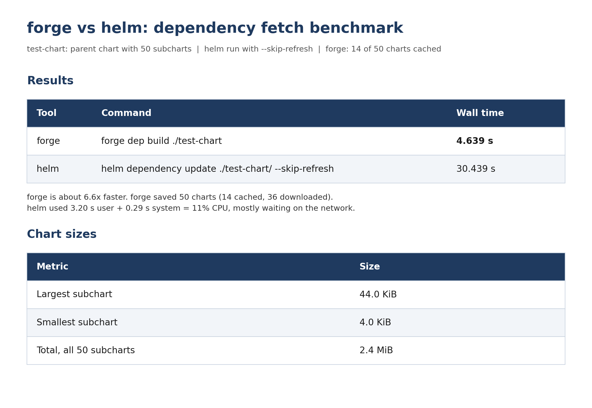

---
hide:
  - navigation
  - toc
---

<div class="forge-hero" markdown>

{ width="160" }

# forge

**A fast `helm dependency build` and `update` with the same output as Helm.**
It is for charts whose dependencies are in OCI registries, classic chart
repositories (`https://…/index.yaml`) or local `file://` directories.

[Get started](#install){ .md-button .md-button--primary }
[Usage guide](usage.md){ .md-button }
[GitHub](https://github.com/mmpyro/forge){ .md-button }

</div>

forge writes the same `charts/*.tgz` and `Chart.lock` as Helm. Thus
`helm template`, `helm install` and `helm package` work without changes. They
only get their dependencies faster.

```sh
helm forge dep update ./my-chart   # resolve ranges, download, write Chart.lock
helm forge dep build  ./my-chart   # download exactly what Chart.lock pins
helm template my-release ./my-chart
```

`helm forge …` (the plugin) and `forge …` (the standalone binary) take the
same commands and flags.

## Why forge

<div class="grid cards" markdown>

-   :material-lightning-bolt:{ .lg .middle } **Parallel**

    ---

    forge fetches all dependencies at the same time, with a global limit and
    a limit for each host.

    [:octicons-arrow-right-24: Limits and retries](architecture.md#limits-and-retries)

-   :material-key-chain:{ .lg .middle } **One auth handshake per registry**

    ---

    The first request to a host runs alone. All other requests use the token
    that it gets.

    [:octicons-arrow-right-24: How it works](architecture.md#one-auth-handshake-per-registry)

-   :material-database-lock:{ .lg .middle } **Content-addressed cache**

    ---

    forge stores archives by sha256. Charts, aliases and processes share
    them. A warm `dep build` sends **zero** requests.

    [:octicons-arrow-right-24: The store](architecture.md#the-store)

-   :material-atom:{ .lg .middle } **Atomic `charts/`**

    ---

    `charts/` changes only if all dependencies succeed.

    [:octicons-arrow-right-24: Atomic charts/](architecture.md#atomic-charts)

-   :material-code-json:{ .lg .middle } **Machine-readable reports**

    ---

    With `-o json`, CI gets a stable error `code` for each failed
    dependency. CI does not have to parse text.

    [:octicons-arrow-right-24: JSON output](usage.md#json-output)

-   :material-scale-balance:{ .lg .middle } **Same output as Helm**

    ---

    CI compares archive bytes, `Chart.lock` (except `generated:`) and
    `helm template` output with real Helm 3 and Helm 4.

    [:octicons-arrow-right-24: Helm is the oracle](architecture.md#helm-is-the-oracle)

</div>

## Install

Select how you run Helm. The docs site keeps your selection on all pages.

=== "Helm 4"

    ```sh
    # git sources can't be signature-verified, so --verify=false is required
    helm plugin install https://github.com/mmpyro/forge --version v2.1.0 --verify=false
    helm forge --version
    ```

=== "Helm 3 (3.18+)"

    ```sh
    helm plugin install https://github.com/mmpyro/forge --version v2.1.0
    helm forge --version
    ```

=== "Binary (macOS / Linux)"

    ```sh
    os=$(uname -s | tr '[:upper:]' '[:lower:]')
    arch=$(uname -m); case $arch in x86_64) arch=amd64 ;; aarch64) arch=arm64 ;; esac
    curl -fsSL -o forge "https://github.com/mmpyro/forge/releases/download/v2.1.0/forge-$os-$arch"
    chmod +x forge && sudo mv forge /usr/local/bin/
    forge --version
    ```

=== "Binary (Windows)"

    Download [`forge-windows-amd64.exe`](https://github.com/mmpyro/forge/releases/download/v2.1.0/forge-windows-amd64.exe)
    or [`forge-windows-arm64.exe`](https://github.com/mmpyro/forge/releases/download/v2.1.0/forge-windows-arm64.exe),
    Rename it to `forge.exe` and put it in a directory on your `PATH`.

    ```powershell
    forge --version
    ```

=== "From source"

    ```sh
    make build            # → bin/forge (Go 1.25+)
    bin/forge --version
    ```

For mirrors, checksums, upgrades and troubleshooting, see
[Usage → Install](usage.md#install).

## What's new in 2.1

- **Inspect dependencies.** `dep tree` shows the constraint, locked version,
  source and cache state of each dependency. `dep why NAME` explains one
  dependency. These two commands send no requests. `dep outdated` compares
  `Chart.lock` with the versions that registries offer now. Use
  `--fail-if-outdated` to stop a CI job when a dependency is outdated. See
  [Usage → `forge dep tree`](usage.md#forge-dep-tree-chart).
- **Manage the cache.** `cache ls` lists the cached charts with their size
  and last use. `cache gc --older-than 30d --max-size 2GiB` removes the least
  recently used charts. You can run it while other forge processes run. See
  [Usage → `forge cache gc`](usage.md#forge-cache-gc).

[Release notes and downloads](https://github.com/mmpyro/forge/releases/tag/v2.1.0).

## What's new in 2.0

- **Chart repositories and `file://` dependencies.** forge now also fetches
  from classic `https://…/index.yaml` repositories, which includes `@name`
  references from `helm repo add`. It also packages local `file://` charts.
- **`-o json` output.** `dep build` and `dep update` can print one JSON
  report. The report gives the status, digest, size and error code of each
  dependency, and the request count for each host. See
  [Usage → JSON output](usage.md#json-output).
- **Helm plugin.** Install forge with `helm plugin install` and run it as
  `helm forge`. The Homebrew tap is discontinued.

## Benchmark

The test used a parent chart with 50 subcharts (2.4 MiB in total).
`forge dep build` took **4.6 s**. `helm dependency update --skip-refresh`
took **30.4 s**. forge was about **6.6× faster**. At the start, forge had 14
of the 50 charts in its cache. Helm spent most of the time on the network
(11 % CPU).



For a comparison that you can repeat (40 charts, +50 ms latency, cold and
warm), run `make bench`. See
[Development → Benchmark](development.md#benchmark-scriptsbenchsh).

## Scope

<div class="grid" markdown>

!!! success "Supported"

    - `apiVersion: v2` charts
    - dependencies with `repository:`
        - `oci://…`: OCI registries
        - `https://…` and `http://…`: classic chart repositories, added with
          `helm repo add` or not
        - `@name` and `alias:name`: repositories from Helm's `repositories.yaml`
          (forge also uses their credentials and TLS settings)
        - `file://…`: local chart directories, packaged as Helm packages them
    - exact versions and semver ranges (with the same resolver rules as Helm)
    - aliases, conditions and tags, prerelease and build-metadata versions

!!! failure "Not supported (forge stops before it sends a request)"

    - dependencies without a `repository` (unpacked in `charts/`), and other
      schemes (`s3://`, plugin getters)
    - `apiVersion: v1` charts

    **Not available yet:** `push`/`pull`, `package`, adaptive concurrency, HTTP/3.

</div>

## Guides

| Guide | Read it to… |
|---|---|
| [Usage](usage.md) | install forge, run it, set flags, cache it in CI, read its errors, parse its `-o json` output |
| [Architecture](architecture.md) | learn how a run works and why it is fast and safe |
| [Development](development.md) | build, test, regenerate goldens, run the compat gate and the benchmark |
